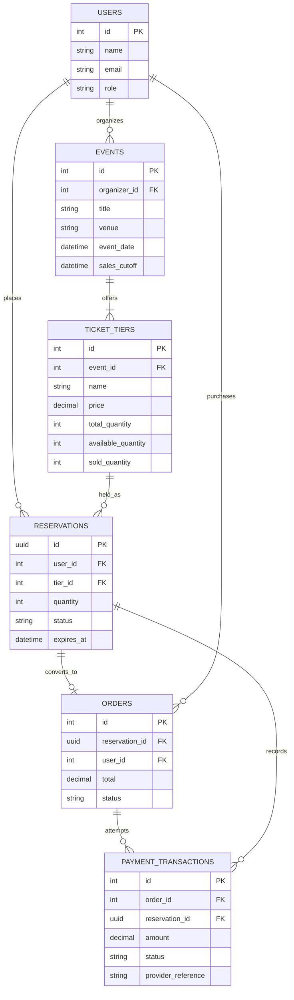

# Eventra ER Diagram

`available_quantity` is decremented inside a PostgreSQL transaction after locking the ticket-tier row. Reservations transition through `HELD`, `PAYMENT_PENDING`, and one terminal state: `CONFIRMED`, `EXPIRED`, or `FAILED`.
